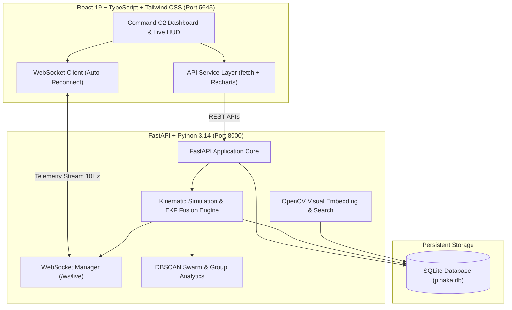

# PINAKA — Multi-Sensor AI for Drone Detection, Tracking & Swarm Analytics

> **Tagline:** *Detect. Understand. Protect.*  
> **Brand Inspiration:** *Pinaka*, the divine bow of Lord Shiva — symbolizing precision, long-range multi-target tracking, and decisive deterrence.

PINAKA is an enterprise aerospace research and situational-awareness command platform designed for multi-sensor counter-UAV (C-UAS) surveillance, kinematic track estimation, and drone swarm analytics.

---

## System Architecture



---

## 1. Backend Architecture (`backend/`)

- **Framework:** Python 3.14 + FastAPI + SQLAlchemy ORM + SQLite
- **Mathematical & ML Stack:** NumPy, SciPy (Spatial clustering & distance matrices), OpenCV (Visual embedding extraction)
- **Real-time Protocol:** WebSockets (`/ws/live`) with asynchronous 100ms broadcasting tick loop
- **State Estimation:** 6-state Extended Kalman Filter ($[x, y, z, v_x, v_y, v_z]^T$) with dynamic covariance updates

### Database Tables (SQLite: `backend/pinaka.db`)
1. `sensors` — Camera, Thermal, Radar, RF status, PTP jitter, SNR quality, specs.
2. `observations` — Discrete sensor observations with timestamps, confidence, and raw payloads.
3. `tracks` — Consolidated fused tracks with kinematic state vectors and bounding boxes.
4. `track_history` — Sequential historical trajectory points for interpolation and CSV export.
5. `system_events` — Real-time event log (fusion locks, RF emissions, operator actions).
6. `operator_reviews` — Human-in-the-loop verification decisions and mission dispatch notes.
7. `simulation_sessions` — Active simulation scenarios and speed parameters.
8. `evaluation_benchmarks` — Comparative benchmarks (Vision-Only vs Multi-Sensor Fused).
9. `reference_snapshots` — 64-dimensional visual feature vectors for airframe similarity search.

---

## 2. REST API Reference

| Method | Endpoint | Description |
|---|---|---|
| `GET` | `/api/health` | Service and SQLite database health check |
| `GET` | `/api/dashboard/stats` | Executive KPI counts, fusion confidence, and latency |
| `GET` | `/api/sensors` | Multi-sensor array status, health, and PTP sync |
| `GET` | `/api/tracks` | Active consolidated airborne tracks |
| `GET` | `/api/tracks/{id}` | Track details and optical bounding box |
| `GET` | `/api/tracks/{id}/history`| Historical observation trajectory points |
| `GET` | `/api/events` | Real-time C2 telemetry event feed |
| `GET` | `/api/analytics/trajectory` | 2D Planar trajectory coordinates |
| `GET` | `/api/analytics/speed` | Speed vs Time series |
| `GET` | `/api/analytics/confidence`| Cross-sensor confidence breakdown over time |
| `GET` | `/api/analytics/groups` | Candidate swarm clusters, convex hull, and cohesion |
| `GET` | `/api/evaluation` | Vision vs Fused benchmark and environmental matrix |
| `POST` | `/api/simulation/start` | Launch simulation engine |
| `POST` | `/api/simulation/pause` | Pause kinematic tick loop |
| `POST` | `/api/simulation/resume` | Resume simulation |
| `POST` | `/api/simulation/reset` | Reset simulation state to baseline |
| `POST` | `/api/simulation/control` | Adjust simulation speed multiplier or switch scenarios |
| `GET` | `/api/simulation/status` | Current tick rate, scenario, and uptime |
| `POST` | `/api/operator/review` | Record human verification (`Verified Hostile`, `Authorized Flight`, etc.) |
| `GET` | `/api/operator/reviews` | Retrieve verification audit log |
| `POST` | `/api/reference/search` | OpenCV visual embedding & text/color airframe search |
| `GET` | `/api/system/status` | Hardware bus, PTP IEEE-1588 lock, and GPU load |

---

## 3. WebSocket Real-Time Stream

- **Endpoint:** `ws://localhost:8000/ws/live`
- **Cadence:** 10 Hz (100ms ticks)
- **Payload:** Broadcasts `TELEMETRY_UPDATE` containing synchronized track coordinates, radar sweep angles, swarm convex hull dispersion metrics, and end-to-end processing latency.

---

## 4. Running the Platform

### Start Backend Server (Port 8000)
```bash
source backend/.venv/bin/activate
export PYTHONPATH=backend
python -m uvicorn app.main:app --host 0.0.0.0 --port 8000
```

### Start Frontend Application (Port 5645)
```bash
npm run dev -- --host --port 5645
```

- **Frontend Application:** [http://localhost:5645/](http://localhost:5645/)
- **Backend API & Swagger Docs:** [http://localhost:8000/docs](http://localhost:8000/docs)
- **API Health Check:** [http://localhost:8000/api/health](http://localhost:8000/api/health)
